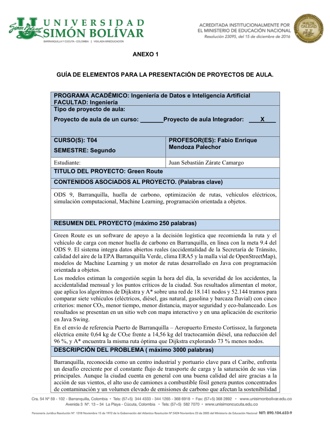
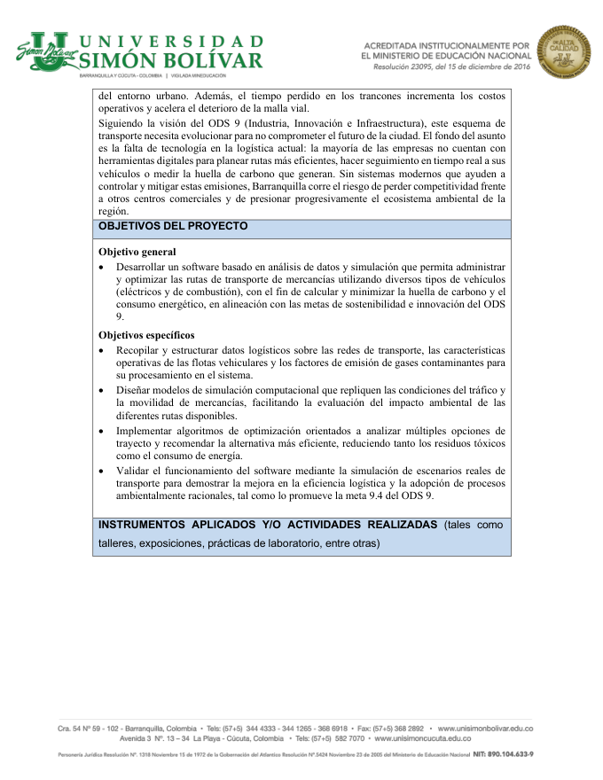
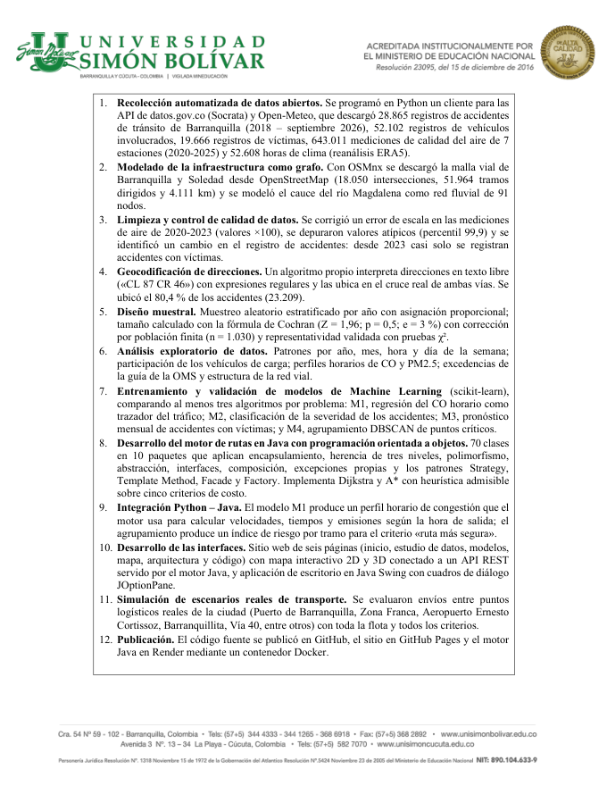
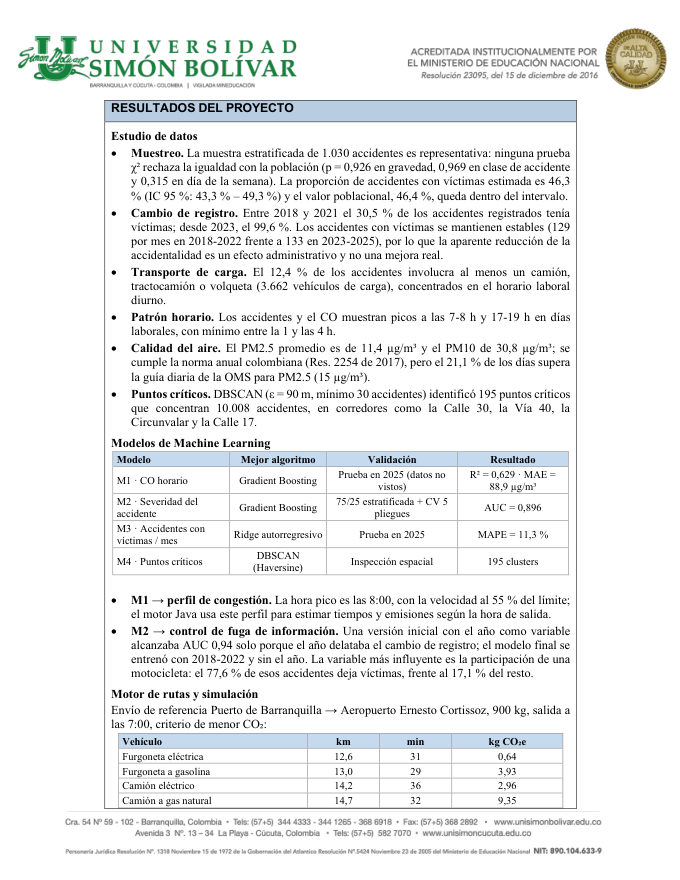
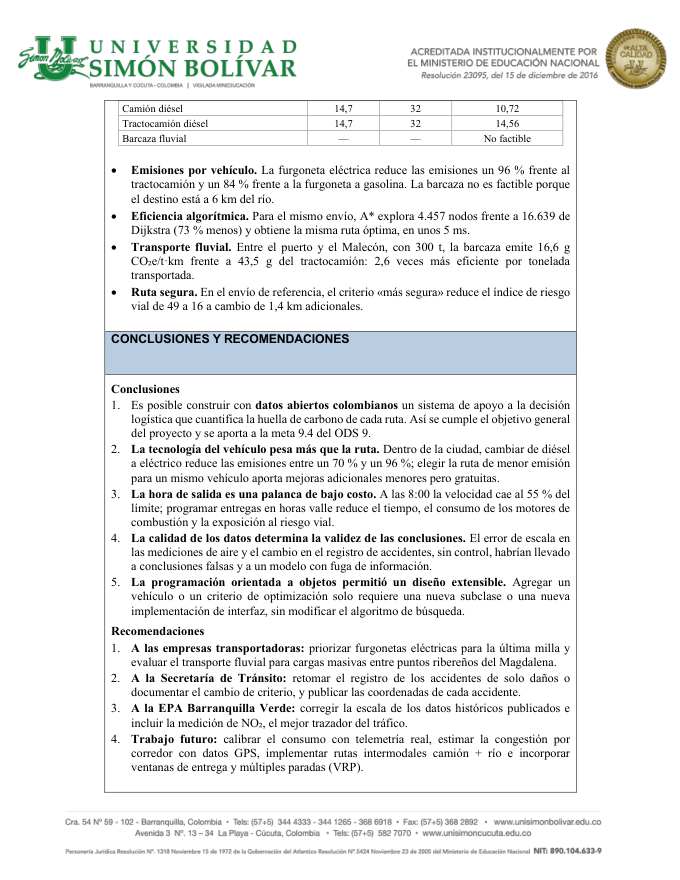
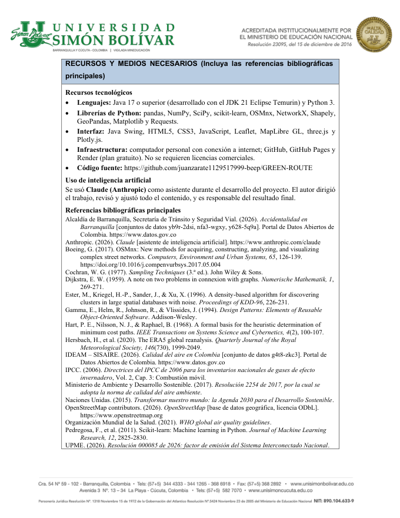

# Green Route

**Rutas de carga de baja huella de carbono para Barranquilla · ODS 9**

Proyecto de aula integrador · Ingeniería de Datos e Inteligencia Artificial · Curso T04 · Segundo semestre\
**Autor:** Juan Sebastián Zárate Camargo\
**Profesor:** Fabio Enrique Mendoza Palechor

Sitio en línea: <https://juanzarate1129517999-beep.github.io/GREEN-ROUTE/>

---

## Documento del proyecto

Formato del proyecto de aula integrador, completamente diligenciado: **[Proyecto integrador (PDF)](docs/Proyecto-integrador.pdf)**

<p>
  <a href="docs/Proyecto-integrador.pdf"></a>
  <a href="docs/Proyecto-integrador.pdf"></a>
  <a href="docs/Proyecto-integrador.pdf"></a>
  <a href="docs/Proyecto-integrador.pdf"></a>
  <a href="docs/Proyecto-integrador.pdf"></a>
  <a href="docs/Proyecto-integrador.pdf"></a>
</p>

**Palabras clave:** ODS 9, Barranquilla, huella de carbono, optimización de rutas, vehículos eléctricos, simulación computacional, Machine Learning, programación orientada a objetos.

## Resumen

Green Route es un software de apoyo a la decisión logística que recomienda la ruta y el vehículo de carga con menor huella de carbono en Barranquilla, en línea con la meta 9.4 del ODS 9. Integra datos abiertos reales (accidentalidad, calidad del aire, clima y la malla vial de OpenStreetMap), modelos de Machine Learning y un motor de rutas en Java orientado a objetos.

El motor aplica Dijkstra y A* sobre una red de 18.141 nodos y 52.144 tramos para comparar siete vehículos (eléctricos, diésel, gas natural, gasolina y barcaza fluvial) con cinco criterios: menor CO₂, menor tiempo, menor distancia, mayor seguridad y eco-balanceado. Los resultados se presentan en un sitio web con mapa interactivo y en una aplicación de escritorio en Java Swing.

## Problema

Barranquilla es un centro industrial y portuario clave del Caribe con vías saturadas por el transporte de carga. Los camiones a combustible fósil concentran emisiones de carbono, y los trancones aumentan los costos operativos y el desgaste de la malla vial. La mayoría de las empresas no tiene herramientas digitales para planear rutas eficientes ni medir su huella de carbono.

## Objetivos

**General:** desarrollar un software basado en análisis de datos y simulación que permita administrar y optimizar las rutas de transporte de mercancías con vehículos eléctricos y de combustión, para calcular y minimizar la huella de carbono y el consumo energético, en línea con el ODS 9.

**Específicos:**

1. Recopilar y estructurar datos sobre la red de transporte, las flotas vehiculares y los factores de emisión.
2. Diseñar modelos de simulación que repliquen el tráfico y la movilidad de mercancías.
3. Implementar algoritmos de optimización que recomienden la ruta más eficiente.
4. Validar el software con escenarios reales de transporte (meta 9.4 del ODS 9).

## Cómo se hizo

1. **Recolección de datos abiertos.** Un cliente en Python descargó de datos.gov.co y Open-Meteo 28.865 accidentes de tránsito (2018-2026), 52.102 vehículos involucrados, 19.666 víctimas, 643.011 mediciones de calidad del aire y 52.608 horas de clima (ERA5).
2. **Red vial como grafo.** Con OSMnx se descargó la malla vial de Barranquilla y Soledad desde OpenStreetMap (18.050 intersecciones y 4.111 km) y se modeló el río Magdalena como red fluvial.
3. **Limpieza de datos.** Se corrigió un error de escala en las mediciones de aire de 2020-2023, se depuraron valores atípicos y se detectó que desde 2023 casi solo se registran accidentes con víctimas.
4. **Geocodificación.** Un algoritmo propio interpreta direcciones como «CL 87 CR 46» y las ubica en el cruce real de ambas vías: se ubicó el 80,4 % de los accidentes.
5. **Muestreo.** Muestra estratificada por año (fórmula de Cochran, n = 1.030) validada con pruebas χ².
6. **Análisis exploratorio.** Patrones por hora, día y mes; participación de la carga; perfiles de CO y PM2.5, y excedencias de la guía de la OMS.
7. **Machine Learning** (scikit-learn), comparando al menos tres algoritmos por problema: tráfico por hora (M1), severidad de accidentes (M2), accidentes por mes (M3) y puntos críticos con DBSCAN (M4).
8. **Motor de rutas en Java.** 70 clases en 10 paquetes con encapsulamiento, herencia, polimorfismo, abstracción, interfaces, excepciones propias y los patrones Strategy, Template Method, Facade y Factory. Implementa Dijkstra y A*.
9. **Integración Python – Java.** El modelo M1 da al motor la congestión de cada hora, y los puntos críticos alimentan el criterio «ruta más segura».
10. **Interfaces.** Sitio web con mapa 2D y 3D conectado a un API REST del motor, y aplicación de escritorio en Java Swing con `JOptionPane`.
11. **Simulación de escenarios.** Envíos entre puntos logísticos reales (puerto, Zona Franca, aeropuerto, Barranquillita, Vía 40) con toda la flota y todos los criterios.
12. **Publicación.** Código en GitHub, sitio en GitHub Pages y motor Java en Render con Docker.

## Resultados

**Modelos de Machine Learning**

| Modelo | Algoritmo | Resultado |
|---|---|---|
| M1 · Tráfico (CO por hora) | Gradient Boosting | R² = 0,629 |
| M2 · Severidad del accidente | Gradient Boosting | AUC = 0,896 |
| M3 · Accidentes con víctimas por mes | Ridge autorregresivo | MAPE = 11,3 % |
| M4 · Puntos críticos | DBSCAN | 195 zonas con 10.008 accidentes |

**Envío de referencia:** Puerto de Barranquilla → Aeropuerto Ernesto Cortissoz, 900 kg, salida a las 7:00, criterio de menor CO₂.

| Vehículo | km | min | kg CO₂e |
|---|---|---|---|
| Furgoneta eléctrica | 12,6 | 31 | 0,64 |
| Furgoneta a gasolina | 13,0 | 29 | 3,93 |
| Camión eléctrico | 14,2 | 36 | 2,96 |
| Camión a gas natural | 14,7 | 32 | 9,35 |
| Camión diésel | 14,7 | 32 | 10,72 |
| Tractocamión diésel | 14,7 | 32 | 14,56 |

- La furgoneta eléctrica emite **96 % menos** que el tractocamión diésel.
- A* encuentra la misma ruta óptima que Dijkstra explorando **73 % menos nodos**, en unos 5 ms.
- A las 8:00 la velocidad cae al 55 % del límite; el 12,4 % de los accidentes involucra un vehículo de carga.

## Conclusiones

1. Con datos abiertos colombianos se puede medir la huella de carbono de cada ruta y aportar a la meta 9.4 del ODS 9.
2. La tecnología del vehículo pesa más que la ruta: pasar de diésel a eléctrico reduce entre 70 % y 96 % las emisiones urbanas.
3. Salir en horas valle reduce tiempo, consumo y riesgo vial sin costo adicional.
4. Revisar la calidad de los datos evitó conclusiones falsas por errores de escala y cambios de registro.
5. La programación orientada a objetos permite agregar vehículos o criterios sin modificar el algoritmo de búsqueda.

## Cómo ejecutarlo

Requisito: **JDK 17 o superior** (por ejemplo, Temurin en <https://adoptium.net>). Los scripts lo buscan solos en `JAVA_HOME`, el `PATH` y las carpetas de instalación habituales.

```powershell
.\greenroute-java\compilar.ps1      # compila el motor
.\greenroute-java\ejecutar.ps1      # sitio + API en http://localhost:8080
.\greenroute-java\escritorio.ps1    # aplicación de escritorio
```

Si Windows bloquea los scripts: `powershell -ExecutionPolicy Bypass -File .\greenroute-java\ejecutar.ps1`. Si el puerto 8080 está ocupado: `.\greenroute-java\ejecutar.ps1 --puerto=8081`.

En macOS o Linux:

```bash
cd greenroute-java
javac --release 17 -encoding UTF-8 -d out $(find src -name "*.java")
java -cp out co.edu.greenroute.App                         # sitio web en http://localhost:8080
java -cp out co.edu.greenroute.escritorio.AppEscritorio    # aplicación de escritorio
```

Los datos y modelos se regeneran con los scripts de `analisis/` (Python 3.11 o superior: `pip install -r analisis\requirements.txt` y luego los scripts `01` a `08` en orden).

## Declaración de uso de inteligencia artificial

Se usó **Claude (Anthropic)** como asistente durante el desarrollo del proyecto. El autor dirigió el trabajo, revisó y ajustó todo el contenido, y es responsable del resultado final.
